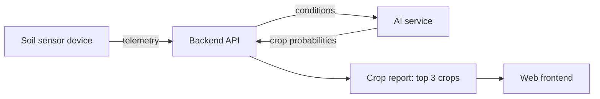

# Qazaq

**AI-powered crop recommendations from soil-sensor data.**

Qazaq is an agricultural analytics platform. Soil sensors in the field send telemetry to a backend API, an AI service analyzes the conditions, and farmers receive a report with the **top 3 recommended crops and their probabilities**.

> **Status:** Prototype built between August and December 2024 and pitched at an AI-in-agriculture competition, where it met the entry criteria. It is not a production system.

---

## The problem

Choosing the right crop depends on soil quality, climate and other conditions that change from field to field. Many farmers decide without data. Qazaq turns live sensor readings into a clear, ranked recommendation so the decision is based on measurements instead of guesswork.

## How it works



1. A sensor device measures soil and environmental parameters and sends telemetry to the backend.
2. The backend validates the data and passes it to the AI service through a dedicated API.
3. The AI service returns probabilities for each candidate crop.
4. The platform generates a crop report with the three best options and their probabilities.

## Features

- **Telemetry analysis:** processes sensor data describing soil quality, climate and other key parameters.
- **AI crop recommendations:** ranks crops by probability for the measured conditions.
- **Crop reports:** generates a report with the top 3 crops and their probabilities.
- **Device management:** administrators can manage unassigned devices and track which user each device belongs to.
- **Dedicated AI integration API:** a separate, secured interface between the backend and the AI service.
- **Containerized setup:** the whole stack starts with one Docker Compose command.

## Tech stack

| Layer | Technology |
| --- | --- |
| Backend | Python, FastAPI, PostgreSQL, Redis, JWT authentication |
| AI service | Python, scikit-learn (Random Forest), pandas, NumPy, joblib |
| Frontend | JavaScript |
| Embedded | Arduino sketch for the sensor device |
| Packaging and CI | Poetry, Docker Compose, GitHub Actions, flake8 |

## Model

- **Algorithm:** Random Forest classifier (scikit-learn, 100 trees) that outputs a probability for each supported crop.
- **Task:** multi-class classification over 26 crops, including field crops, fruits and greenhouse vegetables such as tomato, cucumber and pepper.
- **Input features (11):** nitrogen (N), phosphorus (P), potassium (K), temperature, soil pH, soil humidity, air humidity, light intensity, light duration, CO2 and O2.
- **Training data:** a tabular dataset of 4,200 labeled samples, stored in `ai/data/raw/raw_data.csv`.
- **Output:** the three most likely crops, each with its probability as a percentage.
- **Serving:** the trained model and its label encoder are saved with joblib in `ai/ml_models/` and loaded when the AI service starts. Each prediction is logged with a request ID, and failed predictions are caught and logged instead of crashing the service.

## Project structure

```
qazaq/
├── ai/               # Crop recommendation model and AI service
├── backend/          # REST API, device management, report generation
├── frontend/         # Web interface
├── embedded/         # Sensor device firmware
├── docs/             # Documentation
├── .github/workflows # GitHub Actions workflows
├── docker-compose.yml
└── LICENSE
```

## Getting started

**Prerequisites:** Docker and Docker Compose. Python with Poetry is needed only if you want to run parts of the project outside containers.

1. Clone the repository:

   ```bash
   git clone https://github.com/samiribrh/qazaq.git
   cd qazaq
   ```

2. Install dependencies (optional, for local development):

   ```bash
   poetry install
   ```

3. Configure environment variables. Each service reads its own `.env` file (see `docker-compose.yml`):

   - **`ai/.env`:** `APP_NAME`, `HOST`, `PORT`, `ALLOWED_ORIGINS`, `PROJECT_PATH`
   - **`backend/.env`:** PostgreSQL connection (`POSTGRES_USER`, `POSTGRES_PASS`, `POSTGRES_HOST`, `POSTGRES_PORT`, `POSTGRES_DB`), JWT settings (key paths, passphrase, algorithm, token lifetimes), SMTP settings for email, Redis connection, and the service URLs (`FRONTEND_URL`, `BACKEND_URL`, `AI_URL`, `AI_PREDICT_URL`)

   Never commit real passwords or private keys.

4. Start the application:

   ```bash
   docker-compose up --build
   ```

5. Open the interactive API documentation at <http://localhost:8000/docs>. It lists every endpoint with request and response examples.

## Team

Built by a team of three during a startup project in 2024.

- **Samir Ibrahimov:** project lead. Built most of the system, including the backend API, device management, AI integration and the Docker and CI/CD setup.
- **Kamran and Simara:** built the web frontend and the embedded sensor firmware.

## Limitations and next steps

- This is a prototype, and parts of the code would need refactoring before production use.
- The model has not been validated on real field data at scale.
- Natural next steps: automated tests for the API, model monitoring, and support for more sensor types.

## License

Released under the [MIT License](LICENSE).

## Contact

Samir Ibrahimov: [LinkedIn](https://www.linkedin.com/in/samiribrh/)
